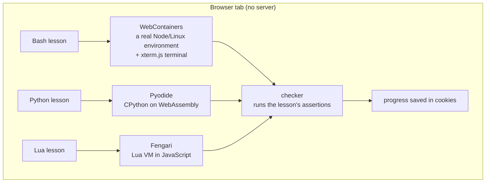

<div align="center">

<h1>BitVoyager</h1>

<p><strong>Learn Bash, Python and Lua through missions in the browser.</strong></p>

<p>
  
  
  
  
  <a href="LICENSE"></a>
</p>

<p>
  <a href="#features">Features</a> ·
  <a href="#getting-started">Getting started</a> ·
  <a href="#adding-content">Adding content</a>
</p>

</div>

BitVoyager is a browser-based platform for learning Bash, Python and Lua through
story-driven missions. Your ship crashes on NEXUS-9, and you work through the planet's
systems one command at a time. Every lesson runs **real** code in the browser — nothing is
simulated and nothing is installed.

## Why

Most "learn to code" sites check your answer against a fixed string, so they only recognize
the exact solution they expect. BitVoyager instead runs your code in a real language runtime
and checks the *result*: did the file get created, does the function return the right value?
That means there are many ways to solve a mission, the feedback is honest, and it all happens
client-side with no backend to run or trust.

## How it works

Each language runs in a genuine runtime compiled to WebAssembly, right in the browser tab:



- **Bash** missions boot a [WebContainer](https://webcontainers.io) — a full Node.js/Linux
  environment in the tab — seeded with the mission's files, and attach an `xterm.js` terminal.
  Your commands run for real, and the checker inspects the resulting filesystem.
- **Python** missions run on [Pyodide](https://pyodide.org) (CPython compiled to WebAssembly).
  The checker runs the lesson's test cases against your code.
- **Lua** missions run on [Fengari](https://fengari.io), a Lua VM in JavaScript, with `print`
  captured so output can be checked.
- **Progress** (your current level and command history) is stored in cookies, so there is no
  account and no server.

## Features

- Three real in-browser runtimes: WebContainers (Bash), Pyodide (Python), Fengari (Lua)
- Story-driven missions with a briefing, an objective, starting files and real success checks
- Mission maps that track your progress through each course (20 Bash, 29 Python, 15 Lua lessons)
- A Bash playground with free practice and tasks suggested from your command history

## Tech stack

React 18, React Router, Tailwind CSS, CodeMirror (editor), xterm.js (terminal) and Vite.

## Getting started

Requires Node.js 18 or later.

```bash
git clone https://github.com/NoamFav/BitVoyager.git
cd BitVoyager
npm install
npm run dev       # http://localhost:5173
```

| Script | Description |
| --- | --- |
| `npm run dev` | Start the development server |
| `npm run build` | Build for production into `dist/` |
| `npm run preview` | Serve the production build |
| `npm run lint` | Run ESLint |
| `npm run deploy` | Build and publish `dist/` to GitHub Pages |

> [!NOTE]
> WebContainers need cross-origin isolation. The dev server sends the required
> `Cross-Origin-Opener-Policy` and `Cross-Origin-Embedder-Policy` headers, and any production
> host must send them too.

## Adding content

Lessons are JSON files in [`src/data`](src/data): `bashLessons.json`, `pythonLessons.json`
and `luaLessons.json`; Bash practice tasks are in `bashPracticeTasks.json`. A Bash mission
looks like this:

```json
{
  "id": 1,
  "title": "Crash Landing",
  "briefing": ["Your ship went down hard on NEXUS-9…"],
  "objective": "A distress beacon needs its activation code.",
  "hints": ["Try `ls` to see what's around you."],
  "cwd": "/home/voyager/landing_zone",
  "files": { "home/voyager/landing_zone/crash.log": "NEXUS-9 EMERGENCY SYSTEM\n…" },
  "check": {
    "all": [
      { "type": "fileExists", "path": "/home/voyager/landing_zone/beacon_status.txt" },
      { "type": "fileEquals", "path": "…/beacon_status.txt", "other": "…/expected.txt" }
    ]
  }
}
```

`files` seeds the WebContainer filesystem, and `check` lists the assertions that must pass for
the mission to be complete. Adding a mission is just adding an entry — no component changes.

## License

Licensed under the [Apache License 2.0](LICENSE). See [NOTICE](NOTICE) for copyright
and attribution notices.
